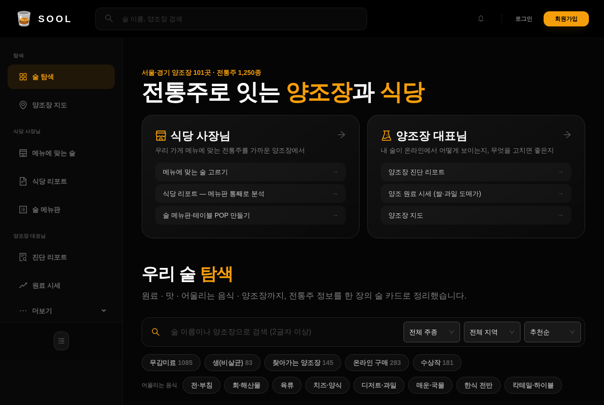
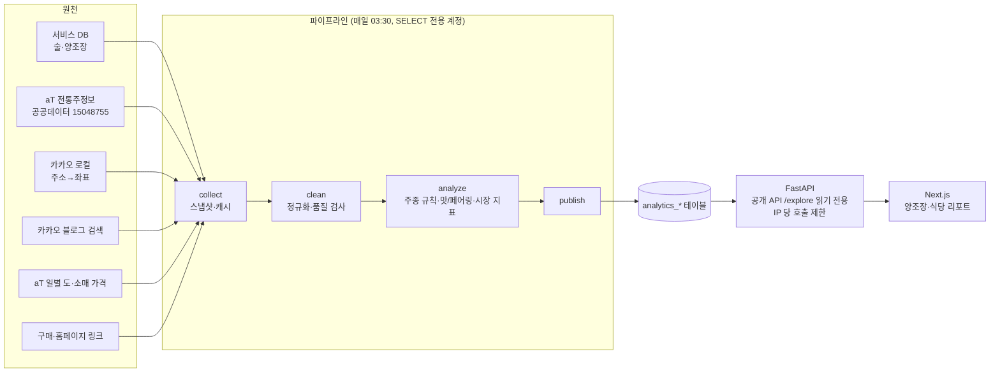
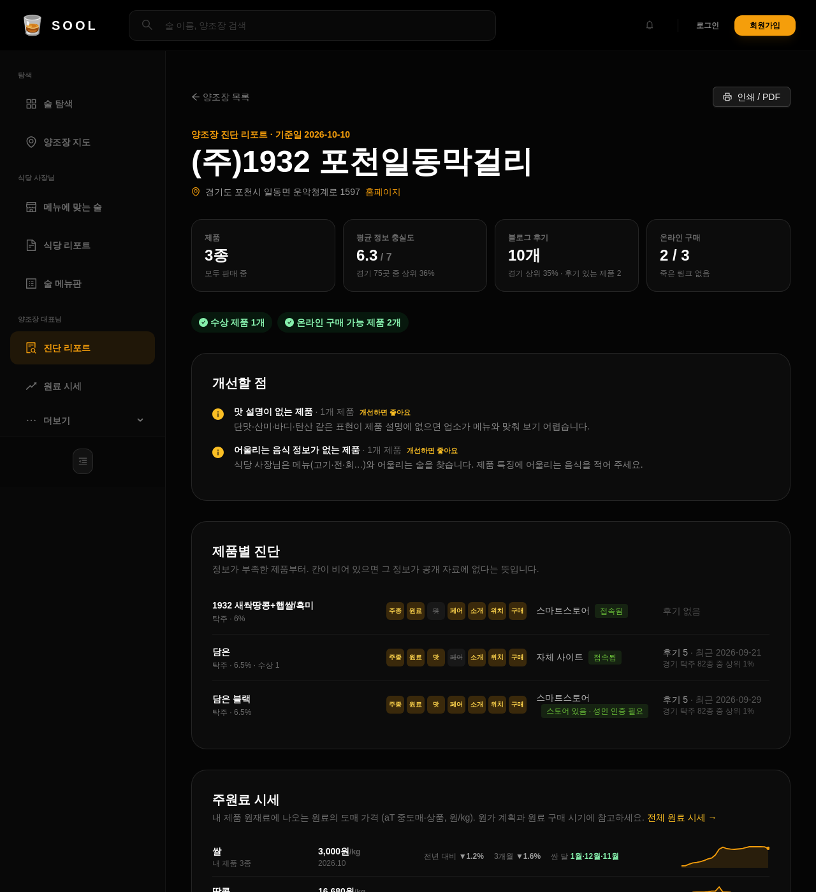
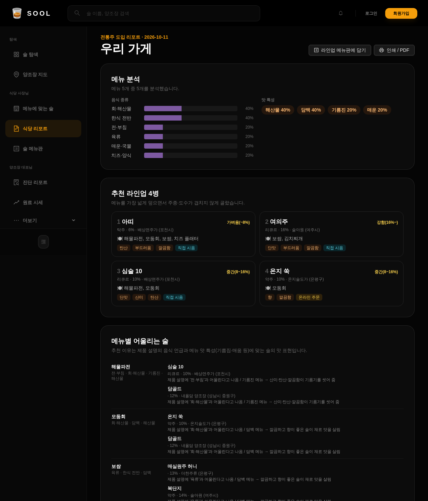
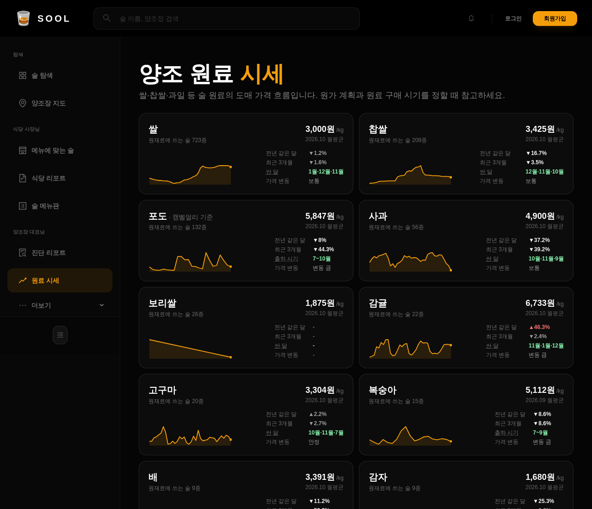
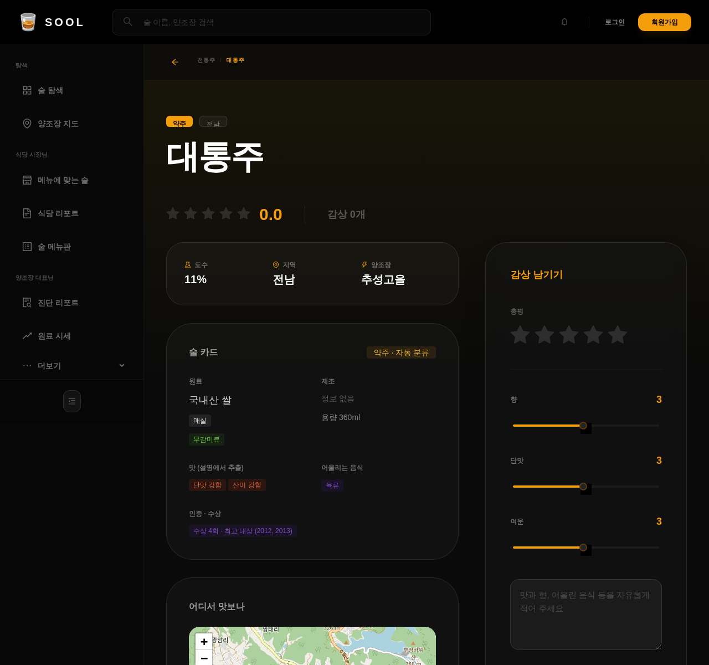
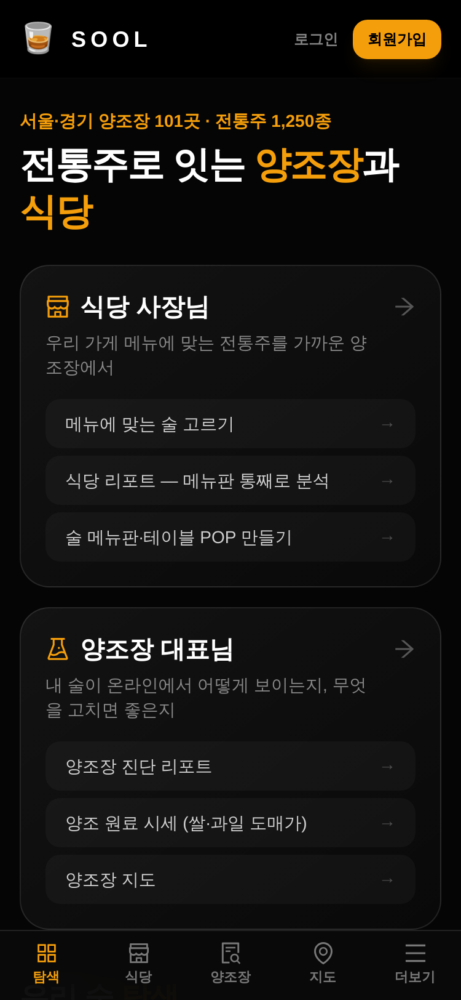
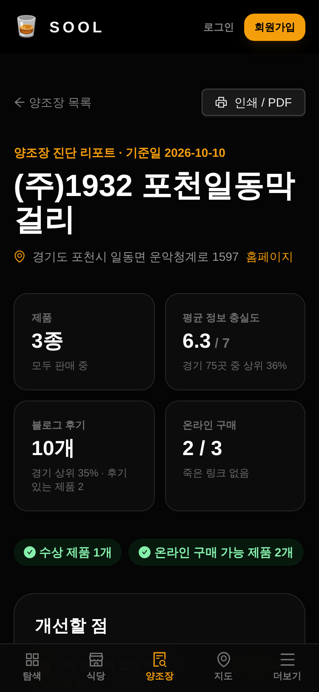

# sool — 전통주로 잇는 양조장과 식당

공공데이터와 웹에 흩어진 전통주 정보를 매일 모아 정리하고, 그 결과로 **양조장 대표**와 **식당 사장님**이 바로 쓸 수 있는 리포트를 만드는 B2B 서비스입니다. 서울·경기 우선 (전국 전통주 1,250종 · 양조장 412곳 중 서울·경기 101곳).



---

## 1. 문제

| | 양조장 대표 (서울·경기 101곳, 대부분 1~5종 소규모) | 식당·주점 사장님 |
|---|---|---|
| 겪는 일 | 마케팅 인력이 없고, **내 술이 온라인에서 어떻게 보이는지 모름** | 소주·맥주 말고 **어떤 전통주를 들여야 할지 모름** |
| 데이터로 본 실제 | 구매·홈페이지 링크 1,037개 중 **274개(26%)가 종료·삭제·오류**, 모두홈페이지 종료 115곳. 맛 설명이 없는 제품 416개(33%) | 메뉴와 어울리는 술·가까운 공급처·손님용 설명 자료가 한곳에 없음 |
| 이 서비스가 주는 것 | **진단 리포트**: 무엇이 비었고 무엇을 고치면 되는지 + 원료 도매 시세 | **식당 리포트**: 메뉴판을 붙여 넣으면 메뉴별 추천 술·라인업·가까운 양조장, 인쇄용 술 메뉴판 |

원칙: 상대편이 가입하지 않아도 **첫날부터 쓸모 있는 도구**부터. 사이트는 주류 거래를 중개하지 않습니다.

---

## 2. 설계



- **분리**: 파이프라인은 서비스 테이블을 읽기만 하고 결과는 `analytics_*` 에만 씁니다 (DB 계정 권한으로 강제). 공개 API 는 `analytics_*` 만 읽습니다.
- **증분 수집**: 좌표·블로그·링크는 캐시하고 바뀐 것만 다시 호출 (전체 재실행 11초, 좌표·블로그 새 호출 0건). aT 원천은 **내용 해시가 바뀔 때만** 새 판으로 저장하고, 이전 판과 비교해 추가·삭제·판매 중단을 감지합니다.
- **제품 연결**: 서비스 DB ↔ aT 원천을 정규화 이름 + 양조장 + 도수로 매칭 (1,183 / 1,250).
- **품질 지표**: 술 카드 7개 항목(주종·원료·맛·페어링·소개·위치·구매) 충실도를 매일 계산해 리포트의 '개선할 점'을 자동으로 만듭니다.
- **운영**: Docker Compose(MariaDB · FastAPI · Next.js), 외부에 열리는 포트는 프론트 하나 (`/api/proxy` → 내부망 백엔드). 매일 03:00 DB 백업 → 구글 드라이브.

---

## 3. 수치 결과 (2026-10-10 실행 기준)

| 항목 | 결과 |
|---|---|
| 술 카드 | **1,250종**, 7개 항목 모두 채움 27.6% · 6개 이상 66.6% |
| 주종 자동 분류 | 미분류 1,248 → 규칙으로 1,175 제안 (**94%**), 남은 73. ⚠️ 정확도는 아직 미측정 |
| 양조장 위치 | 412곳 중 397곳 좌표 확보 (주소 382 · 키워드 검색 15) |
| 구매 경로 | 1,037개 링크를 채널(자체 사이트 575 · 스마트스토어 280 · 모두홈페이지 115 …)과 상태(정상 527 · 성인 인증 211 · 오류 133 · 종료 118 …)로 분류 → 온라인에서 실제로 살 수 있는 술 **283종(22.6%)** |
| 블로그 후기 | 1,105종에 후기 **4,695개** 연결 (이름+양조장 일치 4,072) |
| 원료 시세 | aT 일별 가격 16만+ 행 → 15개 원료 월평균·전년 대비·싼 달, 제품 1,015종과 연결 |
| 시장 구조 | 상위 10곳 점유 12%, 지니 0.437, 지역 특화(LQ) 전북 리큐르 3.79 · 충북 과실주 2.28 |
| 테스트 | 파이프라인 144 · 백엔드 13 |

**한계 (솔직하게)**: 맛·페어링은 판매자 설명 문구에서 뽑아 긍정 편향이 있고, 음식 언급이 없는 술 약 32%는 메뉴 추천에서 빠집니다. 실제 사용자 인터뷰는 아직 0건입니다 (다음 단계).

---

## 4. 화면

| 양조장 진단 리포트 | 식당 리포트 |
|---|---|
|  |  |
| **양조 원료 시세** | **술 상세 (술 카드)** |
|  |  |

모바일(375px)도 가로 스크롤 없이 하단 탭으로 씁니다.

 

---

## 5. 실행

```bash
cp .env.example .env            # DB 비밀번호·SECRET_KEY(openssl rand -hex 32)·API 키 채우기
docker compose up -d --build    # 운영 (서버에서는 ./ops/deploy.sh main)
docker compose --profile pipeline run --rm pipeline run    # 파이프라인 1회 실행
```
- 개발(맥, 핫리로드): `docker compose -f docker-compose.yml -f docker-compose.dev.yml up -d --build`
- 자세한 실행·백업·복구: [RUN_GUIDE.md](RUN_GUIDE.md), 파이프라인: [pipelines/README.md](pipelines/README.md)

**기술**: FastAPI · SQLAlchemy · MariaDB 10.11 / Next.js 16 · Ant Design · Tailwind / Python(pandas · DuckDB) 파이프라인 / Docker Compose

**문서**: [B2B 서비스 기획](docs/decisions/2026-10-10-1846-b2b-service-plan.md) · [파이프라인 설계](docs/decisions/2026-10-10-pipeline-master-plan.md) · [원료 시세 분석](docs/decisions/2026-10-10-2110-ingredient-price-analysis.md) · [로드맵](docs/decisions/2026-10-10-2140-next-roadmap.md) · [작업일지](docs/worklog/)
